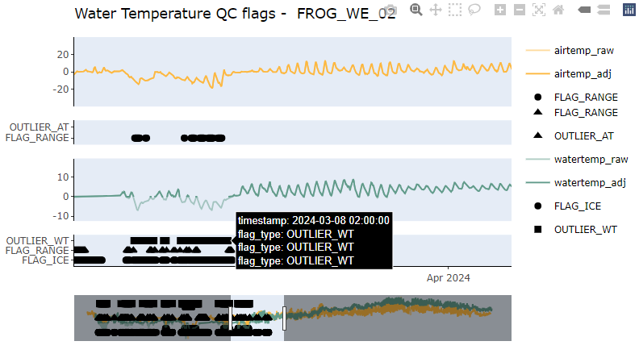
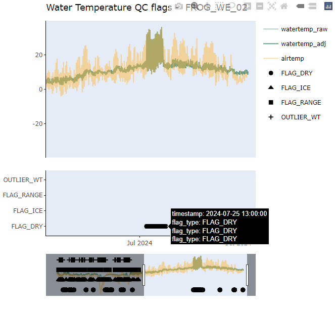

```{r, include = FALSE}
knitr::opts_chunk$set(
  warning = FALSE,
  message = FALSE,
  collapse = TRUE,
  comment = "#>",
  fig.width = 7,
  fig.height = 5
)
```

## Introduction

waterlogged is a data processing package for water data from continuous water data loggers. The goal of water-logged is to streamline the process from raw data to clean data, document quality control processing via logs, and do so without relying on proprietorial software.

This tutorial will guide users through processing temperature data from TibiT loggers. 

## Setup

This vignette assumes you have already installed `waterlogged` from the develop branch:

```r
install.packages("pak")
pak::pkg_install("dfo-pacific-science/waterlogged@main")
```

```{r setup}
library(waterlogged)
```

## Prepare Raw Data

In most cases, there will be data for multiple loggers or downloads for a single station. These need to be bound together to create a single data file for each station. 

Also, data needs to be trimmed to the install and removal dates in case loggers were activated prior to install, or if they were removed before downloading the data (which is typically the case). 

To do this, you will need 2 things:

1. Folder containing raw .csv files exported from HOBOware (*tidbit_folder*) 
    - we recommend keeping csv files from different loggers separate in different folders, and organizing logger folders by year and processing-stage. ie. a file path to the raw air temperature data would be: "data/tidbit/2024/raw"
2.  A .csv of metadata (*metadata_file*) containing:
    - *sn* serial number of logger
    - *site_station_code* A unique ID for the station where the logger was deployed
    - *timestamp_deployed* timestamp of logger deployment
    - *timestamp_removed* timestamp of logger removal
    - *status* status of logger (logging, lost, removed)
    

Define paths to the test data.

```{r paths}
metadata_file  <- system.file("extdata/metadata/metadata.csv", package = "waterlogged")
baro_folder    <- system.file("extdata/water_temperature/airtemp", package = "waterlogged")
log_root_folder <- tempdir()
```

The function **bind_hobo_files** will load all .csv files in the *path_to_raw_folder*, match loggers with the *metadata* file, trim logger data by to only those timestamps within install/remove dates, and bind data from loggers by each station/location and year. The raw folder must ONLY contain raw logger CSV files of the same metric (ie. all logger files are from barometric pressure loggers). 

To save bound files, specify the path to the desired output folder with the optional variable *path_to_output_folder*.

```{r at-baro}

at_bound <- bind_hobo_files(
  path_to_raw_folder = airtemp_folder,
  metadata  = metadata_file,
)

# to see the trimmed and re-bound baro dataset, save the first element of the list as a dataframe:
at_data <- at_bound[[1]]

# to see summary plot
at_bound[[2]]

# summarize the trimmed and bound data
cat("AT data:", nrow(at_data), "rows,",
    length(unique(at_data$site_station_code)), "stations\n")

```

Now we have individual files for airtemp data at each station and year saved in their respective folders, and a trimmed dataset of all input at files saved in the environment as **at_data**.

## Automated Quality Control Protocols

Runs dataset through automated data outlier removal and flags, determined by user-modifiable thresholds. The default thresholds are as follows:

-	temp_high_flag: Temperature readings above this value will flagged as FLAG_RANGE in flag_code column. Default is 50°C.
-	temp_low_flag: Temperature readings below this value will be flagged as FLAG_RANGE in flag_code column. Default is -20°C.

Let's say that the loggers deployed at our site are only operational within -20C and 40C and we need to remove all temperature values that exceed these limits. We can set high and low temperature limits in *qc_airtemp* to remove outliers beyond those limits. We also do not expect air temperature to drop below -10 at this location, and so we want data flags to be produced for values beyond this limit. We can set the lower flagging limit to suit our needs.

The optional input variable *log_root* is the path to the desired folder where a CSV file of all QC flags and adjustments are stored, by logger station. 

```{r at-qaqc}
at_qc <- qc_airtemp(
  input_data = at_data,
  temp_high_limit = 40,
  temp_low_limit = -20,
  temp_low_flag = -10,
  log_root = log_root_folder,
  select_station = unique(at_data$site_station_code)[1]
)

cat("AT QAQC complete:", nrow(at_qc), "rows\n")
cat("  Air Temp. outliers:      ", sum(at_qc$OUTLIER_AT, na.rm = TRUE), "\n")
cat("  Air Temp. flags:      ", sum(at_qc$FLAG_RANGE, na.rm = TRUE), "\n")
head(at_qc, 3)

```

Note that data labeled as OUTLIER have been removed (114 data points), while the data labeled as FLAG_RANGE are retained for visual inspection. The QC log produced will look like this:


```{r log}

system.file("extdata/qaqc_logs/FROG_WE_02_AT_qaqc_log.csv", package = "waterlogged")

```


### Visual Review

Creates an interactive multi-panel plot for reviewing the data and either accepting or rejecting automated data flags. 

How to read the plot:

- Light traces = raw values (original, unmodified)
- Dark traces = adjusted values (after auto QAQC)
- Black symbols = flagged data (ice, dry, error)
- Use the range slider at the bottom to zoom into specific periods
- Hover over points for exact values and timestamps

```{r visual-review, fig.height=10, fig.width=7}
plot_qaqc_timeseries(
  airtemp_data      = at_qc,
  select_station = unique(at_data$site_station_code)[1],
  static = TRUE
)
```

The data can be inspected by clicking and dragging over a section of the graph. If we are happy with the adjusted values retained, we can end our QC here. 

We can also remove data manually with the function *adjust_logger_NA*. Let's say that, during a site visit to FROG_WE_02 at "2024-07-29 16:00:00", when removing the air temperature logger for inspection, the technician dropped the logger in the stream and could not retrieve it. The next day, the logger was found and re-installed at "2024-07-30 9:45:00". This "disturbance" event was recorded in field notes. Since the logger was recording water temperature, not air temperature, during that time period, those data should be removed. 

If we zoom in on that section of the timeseries, we can see a small dip in temperature. This isn't flagged as an outlier, as it is within the defined temperature range. This disturbance event can be removed manually, as follows:


```{r adjust-at, fig.height=10, fig.width=7}
at_qc2 <- adjust_logger_NA(
  input_data       = at_qc,
  select_station   = unique(at_data$site_station_code)[1],
  metric           = "airtemp",
  reason_to_adjust = "disturbance",
  timestamp_start  = "2024-07-29 16:00:00",
  timestamp_end    = "2024-07-30 09:45:00",
  manual_note      = "Logger dropped in stream - reinstalled next day",
  log_root = log_root_folder
)

```

## Final Review

These changes can be reviewed by re-running the plot function. Zoom in on the disturbance time period to make sure the desired values were removed.  The adjusted traces should look reasonable with no obvious artifacts. Compare raw (light) vs adjusted (dark) to see exactly what changed.


```{r visual-review2, fig.height=10, fig.width=7}
plot_qaqc_timeseries(
  airtemp_data      = at_qc2,
  select_station = unique(at_data$site_station_code)[1],
    static=TRUE
)
```


Once all data are reviewed and accepted, we can now save and export our clean data. 

## Export Clean Data (v1.0)

Writes the final cleaned data to CSV files, one per station per year.

What gets exported:

- `site_station_code`, `timestamp` (identifiers)
- `airtemp_C`, `airtemp_C_adj` (raw and adjusted air temperature)
- All `FLAG_*`, `OUTLIER_*` columns (the full audit trail)

```{r final-summary}
cat("Final dataset:", nrow(at_qc), "rows x", ncol(at_qc), "columns\n\n")

cat("\nSummary of raw AT (degrees C):\n")
print(summary(at_qc2$airtemp_C))

cat("\nSummary of adjusted AT (degrees C):\n")
print(summary(at_qc2$airtemp_C_adj))
```


```{r export, eval=FALSE}
write_clean_data(
  input_data            = at_qc2,
  path_to_output_folder = output,
  metric                = "airtemp"
)
```


## Re-run example for water temperature

```{r wt-bound}

wt_bound <- bind_hobo_files(
  path_to_raw_folder = watertemp_folder,
  metadata  = metadata_file,
)

# to see the trimmed and re-bound baro dataset, save the first element of the list as a dataframe:
wt_data <- wt_bound[[1]]

# to see summary plot
wt_bound[[2]]

# summarize the trimmed and bound data
cat("WT data:", nrow(wt_data), "rows,",
    length(unique(wt_data$site_station_code)), "stations\n")

```

The default thresholds for water temperature are as follows:

-	temp_high_limit: Temperature readings above this value will be removed and flagged as OUTLIER_WT. Default is 50°C.
-	temp_low_limit: Temperature readings below this value will be removed and flagged as OUTLIER_WT. Default is -1°C.
- temp_zero_correction: Temperature readings between this value and 0°C will be corrected to 0°C and flagged as FLAG_RANGE. Default is -1°C.
-	temp_ice_threshold_C: Temperature readings below this value will be flagged as FLAG_ICE. Default is 0.3°C.
-	temp_high_dry_C: Temperature readings above this value will be flagged as FLAG_DRY. Default is 25°C.
-	temp_air_water_diff_C: Optional: Temperature readings of water temperature and air temperature that overlap by this amount for 12 consecutive readings will be flagged as FLAG_DRY. Default is a difference of 2°C. This requires an additional column, airtemp_C, to be present in the input data. If no airtemp_C column present, no flags will be created. 

Since we have air temperature from the previous section, we can add it into the water temperature data to help identify dry periods. 

```{r wt-at-join}
at_qc3 <- at_qc2 |> dplyr::select(timestamp, airtemp_C)
wt_data2 <- dplyr::left_join(wt_data, at_qc3, by = "timestamp")

```

Note: We want air and water temperature values within 1C of each other over 12 hours to be flagged, so we change the default value of 2 in the qc_watertemp function.                            

```{r wt-qaqc}
wt_qc <- qc_watertemp(
   input_data = wt_data2,
   log_root = log_root_folder,
   temp_air_water_diff_C=1,
   select_station = unique(wt_data$site_station_code)[1]
)

cat("WT QAQC complete:", nrow(wt_qc), "rows\n")
cat("  Water Temp. outliers:      ", sum(wt_qc$OUTLIER_WT, na.rm = TRUE), "\n")
cat("  Water Temp. corrected to 0:      ", sum(wt_qc$FLAG_RANGE, na.rm = TRUE), "\n")
cat("  Water Temp. FLAG_ICE:      ", sum(wt_qc$FLAG_ICE, na.rm = TRUE), "\n")
cat("  Water Temp. FLAG_DRY:      ", sum(wt_qc$FLAG_DRY, na.rm = TRUE), "\n")

head(wt_qc, 3)

```

If you have two different logger types at the same station, you can plot both to help identify data errors.We can add the air temp data from previously to the water temp data for the station FROG_WE_02. 

```{r visual-review3, fig.height=10, fig.width=7}
plot_qaqc_timeseries( watertemp_data = wt_qc,
  select_station = unique(at_data$site_station_code)[1],
  static = TRUE
)
```

## Identifying periods of ice

Decisions on removing outliers in data should be documented (Note: this is done automatically in the qc_log), informed by local conditions or logger parameters, and consistent across stations, sites and projects. waterlogged provides data flags to assist with identifying erroneous data and outliers, but the ultimate decision on data removal is decided by the user. 

In the water temperature timeseries, we can see quite a few segments are identified as outliers, and flagged as ice. When loggers become frozen in water, the sensor can become trapped in an air pocket, causing readings below zero. These periods should be removed, as the logger is not reading water, but rather the air trapped within the ice. In temperate regions, winter water temperatures should be higher than air temperature. This can also help detect ice periods if water temperature is the same as, or below air temperature during the winter. 

To identify the start and end of ice periods, you can use the FLAG_ICE markers for a conservative approach (where all water temperature values below 0.3C are removed and considered ice), or the OUTLIER_WT markers for a more liberal approach, allowing water temperature values between -1C and 0C to be corrected to 0C, and all values below -1C to be removed and considered ice. We will use a more liberal approach, using the OUTLIER_WT markers as an example. 

The first OUTLIER_WT occurr on 2023-10-26 06:00:00 when water temperature drops below -1. The air temp logger around this time is reading ~-1C as well, indicating potential for the water temperature logger to be reading the temperature of air trapped in ice, rather than true water temperature. Within the OUTLIER_WT period that extends until March 2024, water temperature is flatlining, dropping below -1 and spiking above 0 erratically, further indicating that the sensor is not reading flowing water.  Evidence that the logger is encased in ice is also seen in the large drop in water temperature down to -11C in Jan 2024. 

To identify the end of the ice period, zoom in on the segment between Mar 2024 and May 2024. The OUTLIER_WT segment ends on 2024-03-08 02:00:00. After 2024-03-08 02:00:00, there is a clear difference in the pattern of the temperature readings, where now water temperature and air temperature are hovering around 0C and water temperature is showing a dampened, repeating diurnal pattern, typical of temperate stream flowing water. This indicates that the sensor is now reading water temperature, rather than air temperature. We will remove the section between the first and last OUTLIER_WT flags as a frozen period. Make a note of your rationale in the *manual_note* variable. 




```{r adjust-wt, fig.height=10, fig.width=7}
wt_qc2 <- adjust_logger_NA(
  input_data       = wt_qc,
  select_station   = unique(wt_data$site_station_code)[1],
  metric           = "watertemp",
  reason_to_adjust = "ice",
  timestamp_start  = "2023-10-26 06:00:00",
  timestamp_end    = "2024-03-08 02:00:00", 
  manual_note      = "Accept outlier flags. Negative WT, erratic temperature readings, and flatlines indicate frozen sensor.",
  log_root = log_root_folder
)

```

Review the changes by re-plotting the adjusted data. You should see that the time period we specified previously as ice should be removed in watertemp_adj. 

```{r visual-review4, fig.height=10, fig.width=7}
plot_qaqc_timeseries( watertemp_data = wt_qc2,
  select_station = unique(at_data$site_station_code)[1],
  static=TRUE
)
```

## Identifying dry periods

watertemp_qc provides automatic flags for likely dry periods using default or user-defined limits. These flags should be inspected before removing data outliers.

In the plotly figure, we can see a FLAG_DRY that coincides with a large spike in water temperature in July. Zoom in on this time period in the water temperature figure to inspect it. The diurnal range of water temperature overlaps completely with the diurnal range of air temperature, and this is sustained for a long period of time: 2024-07-07 11:00:00 to 2024-07-25 13:00:00. This is clearly a period of time where the logger was dry and water temperature data should be removed. 



The other periods of dry flags do not show the same magnitude and duration of overlap and can be ignored. 

```{r adjust-wt, fig.height=10, fig.width=7}
wt_qc3 <- adjust_logger_NA(
  input_data       = wt_qc2,
  select_station   = unique(wt_data$site_station_code)[1],
  metric           = "watertemp",
  reason_to_adjust = "dry",
  timestamp_start  = " 2024-07-07 11:00:00", 
  timestamp_end    = "2024-07-25 13:00:00", 
  manual_note      = "Accept dry flags. Range of diurnal water temperature overlaps with air temperature for multiple days, indicates dry sensor.",
  log_root = log_root_folder
)

```

```{r visual-review5, fig.height=10, fig.width=7}
plot_qaqc_timeseries( watertemp_data = wt_qc3,
  select_station = unique(at_data$site_station_code)[1],
  static=TRUE
)
```

Compare the summaries of the raw to adjusted values after removing the ice and dry periods. We now have a minimum water temperature of 0C, rather than -11C, and a maximum water temperature of 18C, rather than 36C, which is a much more reasonable range for water temperature. 

```{r final-summary2}
cat("Final dataset:", nrow(wt_qc3), "rows x", ncol(wt_qc3), "columns\n\n")

cat("\nSummary of raw WT (degrees C):\n")
print(summary(wt_qc3$watertemp_C))

cat("\nSummary of adjusted WT (degrees C):\n")
print(summary(wt_qc3$watertemp_C_adj))
```

The QC'd data can be exported as clean data to the desired output location. 

```{r export2, eval=FALSE}
write_clean_data(
  input_data            = wt_qc3,
  path_to_output_folder = output,
  metric                = "watertemp"
)
```
