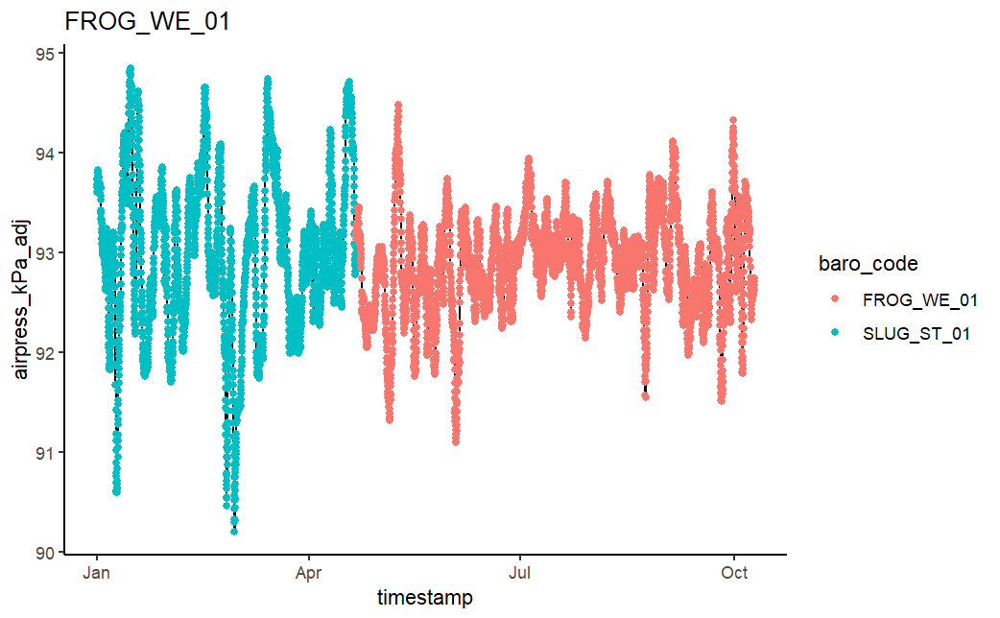

```{r, include = FALSE}
knitr::opts_chunk$set(
  collapse = TRUE,
  comment = "#>"
)
```

```{r setup}
library(waterlogged)
library(knitr)
library(ggplot2)
library(dplyr)
library(tidyr)
library(plotly)
library(purrr)
library(lubridate)
```

# Welcome 

water-logged is a data processing package for water data from continuous water data loggers. The goal of water-logged is to streamline the process from raw data to clean data, document QAQC processing via r scripts, and do so without relying on proprietal software. 

This version of the package was built for data from Onset HOBO barometric pressure (U20), dissolved oxygen (U26), and TibiT loggers. Future versions will test this package on data from other types of loggers to try to make it a more universal package. 


$~$

# Prep: Download data from HOBO loggers

$~$

1. Connect shuttle to computer and load in HOBO
2. We recommend saving file name as [SHORTHAND For VARIABLE]_[SITENAME]_[SERIALNUMBER]_[DATEDOWNLOADED YYYYMMDD]
3. Bulk export of csvs: HOBOWARE PRO > Tools > Bulk Export > Select folder containing hobo files

Exported csvs will have this structure (not R-friendly)

   - row 1: Plot Title
   - row 2: headers
   - row 3: start of data
   - column 1: index
   - column 2: DateTime in format mm/dd/yyyy hh:mm
   - column 3: Abs Pres
   - column 4: Temp
   - column 5+ additional logger outputs
   
Here is an example of what the raw file from HOBO should look like:

$~$

```{r raw-ex, echo = FALSE}

baro <- read.csv(system.file("extdata/ex-baro", "raw_data_hobo_u20_baro1.csv", package = "waterlogged"))

head(baro)
```
$~$

# Step 1: Bind logger data for each logging station

$~$

In most cases, there will be data for multiple loggers or downloads for a single station. These need to be bound together to create a single data file for each station. 

Also, data needs to be trimmed to the install and removal dates in case loggers were activated prior to install, or if they were removed before downloading the data (which is typically the case). 

To do this, you will need 2 things:

1. Folder containing raw .csv files exported from HOBOware. 
    - we recommend keeping csv files from different loggers separate in different folders, and organizing logger folders by year and processing-stage. ie. a file path to the raw water-level logger data would be: "data/waterlevel/2024/raw"
2.  A .csv of metadata (NorthThompson_logger_deployments.csv) containing:
    - *sn* serial number of logger
    - *site_station_code* A unique ID for the station where the logger was deployed
    - *timestamp_deployed* timestamp of logger deployment
    - *timestamp_removed* timestamp of logger removal
    - *status* status of logger (logging, lost, removed)
    
Our metadata file looks like this:

$~$

```{r meta-ex, echo = FALSE}

metadat <- read.csv(system.file("extdata/ex-site-attribute", "logger_manager.csv", package = "waterlogged"))

head(metadat)
```
$~$

The function **bind_hobo_files** will load all .csv files in the *path_to_raw_folder*, match loggers with the *metadata* file, trim logger data by to only those timestamps within install/remove dates, and bind data from loggers by each station/location and year. 

*path_to_output_folder* is where you would like the bound files to be saved. 

*logger_type* The type of HOBO logger that produced the raw datafiles. Recognised logger_types are: dissolvedoxygen_U26, baro_U20, waterlevel_U20, and temperature_TidbiT


Here is an example of running the function on barometric data from a HOBO U20 logger:

$~$

```{r bind-ex, eval = FALSE}

raw_dir <- "REPLACE WITH DESIRED RAW BARO FOLDER PATH"  #the folder where you've stored your raw csv's (ie. "data/baro/2024/raw")

# to run this example using our data, you can access raw hobo files here:
raw_dir <- system.file("extdata/ex-baro/raw", package = "waterlogged")

out_dir <- "REPLACE WITH DESIRED OUTPUT FOLDER PATH FOR BARO DATA"  #from this folder (ie. "data/baro/2024/raw" or simply the Desktop of your local computer), bind_hobo_files will look for a year folder corresponding to your logger data, and if one isn't made, it will create a new year folder and a "processed" folder to store your processed data (ie. "data/baro/2024/processed")

baro_bound <- bind_hobo_files(path_to_raw_folder = raw_dir, 
                              path_to_output_folder = out_dir, 
                              logger_type = "baro_U20", 
                              metadata = metadat)

```

After you run bind_hobo_files, messages will appear telling you what files were saved where. For our example data, this looks like:
[1] "Data (v0.1) from FROG_WE_01 added to 2024 folder"
[1] "Data (v0.1) from SLUG_ST_01 added to 2023 folder"
[1] "Data (v0.1) from SLUG_ST_01 added to 2024 folder"
[1] "List returned: [1] trimmed and compiled dataset of csvs in raw folder [2] file summary of csvs in raw folder [3] summary plots of data by site_station_code and timestamp"
[[1]]

**Note: the suffix v0.1 indicated that this is the first version of processed data, where raw data has been trimmed, variables renamed, and data saved by calender year. Other suffixes will be introduced later. The suffixes are useful for tracking down errors in data processing steps.**

Now we have individual files for barometric data at each station and year saved in their respective folders, and a trimmed dataset of all input baro files saved in the environment as **baro_bound**.

To see the trimmed and re-bound baro dataset, save the first element of the list as a dataframe:

```{r bind-hidden, echo=FALSE}
baro_bound <- readRDS(system.file("extdata/ex-baro/baro_bound.rds", package = "waterlogged"))

```

```{r bind-ex2}
baro_dat <- data.frame(baro_bound[1])

```
A summary of all raw logger files, their SN and variables are saved as the 2nd object of the list.

```{r bind-ex3}
baro_bound[2]

```

To view a summary plot of the trimmed data, select the third object in the list.

```{r bind-ex4}
baro_bound[3]
```

$~$

This is what the output csvs (individual station data) look like (Compare it to the raw hobo file output from above).

$~$

```{r raw-ind, echo=FALSE}

readRDS(system.file("extdata/ex-baro/SLUG_ST_01_BARO_20240101_20241010_v0.1.rds", package = "waterlogged")) %>%
  head()

```

Use the same function for all other logger types. Let's look at the output of *bind_hobo_files* for a waterlevel logger at a site with the *site_station_code* FROG_WE_01.

$~$

```{r wl-ex, echo = FALSE}
wl_dat <- readRDS(system.file("extdata/ex-waterlevel", "FROG_WE_01_WL_20240101_20241009_v0.1.rds", package = "waterlogged"))

head(wl_dat)

```

$~$

# Step 2: Convert Raw Measurements to Usable Metrics

$~$

Hobo water level loggers are not vented meaning they read both the pressure of the water above them and the atmospheric pressure; this is why waterlevel is currently recorded as "Absolute Pressure", rather than a more useful metric, such as metres. In order to correct for this, we must apply a barometric compensation equation to each timestamp of waterlevel data. Barometric data can be obtained from a U20 installed above water (ie. in a nearby tree) at a nearby location as the waterlevel logger. Or hourly barometric pressure can be obtained from nearby weather stations. Regardless, the barometric data used must contain the following columns and formatting:


   - *site_station_code* used to index to metadata for closest baro logger
   - *timestamp*  used to join waterlevel or dissolved oxygen data to baro data for each timestamp
   - *airpress_kPa_U20* barometric pressure is in kPa, used to calculate percent saturation


$~$

We have barometric loggers for some sites, but not all. If a site with a water level logger or dissolved oxygen logger does not have it's own barometric logger, we want to use the closest one that has data for the water level or dissolved oxygen time range.

**add_nearest_baro** performs three tasks

1. Binds the closest barometric logger to the target logger at each station using metadata provided by the user
2. Fills in gaps in barometric data from
one station with baro data from the
next closest station
3. Corrects for jumps in pressure due to differences in altitude between logger locations

The input data with barometric data added as additional coluns is then exported with suffix of v0.2.

The metadata must include the following columns:

- *site_station_code* unique identifier for site/station of loggers, must match header and code in input_data
- *logger_type* type of logger located at each site_station_code. Accepted types are **baro_U20**, **waterlevel_U20**, **dissolvedoxygen_U26**. 
- *latitude* in decimal degrees
- *longitude* in decimal degrees

Here is an example of putting together the required metadata

$~$

```{r baro-meta, echo = FALSE}
baro_metadat <- read.csv(system.file("extdata/ex-site-attribute", "site_station_manager.csv", package = "waterlogged"))

head(baro_metadat)

```

$~$

This is an example of running the function, using the bound baro and waterlevel datasets we made in Step 1
$~$

```{r baro-ex, eval = FALSE}
out_dir <- "REPLACE WITH DESIRED OUTPUT FOLDER PATH FOR WATERLEVEL DATA"

wl_baro_dat <- add_nearest_baro(input_data = wl_dat, 
                                input_logger_type = "waterlevel_U20",
                                path_to_output_folder = out_dir,
                                baro_data = baro_dat,
                                metadata = baro_metadat)

```
$~$
The following message will appear, indicating that barometric data was successfully added to your waterlevel data:
[1] "Barometric pressure data (v0.2) from FROG_WE_01 added to 2024 folder"

**Note: the suffix "v0.2" indicates that this is the second version of processed data, where now barometric data has been added as new columns**

This is what the dataset output now looks like:

```{r baro-dat-added, echo = FALSE}
wl_baro_dat <- readRDS(system.file("extdata/ex-waterlevel", "FROG_WE_01_WL_20240101_20241009_v0.2.rds", package = "waterlogged"))

head(wl_baro_dat)

```

Our water level dataset now has a few extra columns: 

  + *baro_code* shows the nearest barometric logger with available data for that timestamp
  + *airpress_kPa_U20* shows the air pressure recorded at the barometric logger
  + *airtemp_C_U20* shows the air temperature recorded at the barometric logger

If the nearest barometric logger does not cover the entire observation period of the dissolved oxygen file, data from the second nearest barometric logger will be added. Because these loggers may be at different elevations, a small adjustment needs to be made to the pressure values..

*press_diff* the difference in air pressure between subsequent observations at barometric loggers if data from two different loggers were stitched together. This difference is then added/subtracted from the second barometric data to adjust for elevation. These new values are reflected in *airpress_kPa_U20_adj*

The plot that pops up after running **add_nearest_baro** should show a continuous line of varying air pressure values - any breaks or gaps in the line would indicate that an adjustment in pressure between sites of different elevations should be made..

*Note: the air temperature is taken from the barometric logger location, which is not neccessarily the same site as the dissolved oxygen logger - care should be taken for analyses attributing air temperature to a specific location when the baro_code is not the same as site_station_code*

```{r baro-plot, echo = FALSE}

```

## Waterlevel: Apply barometric compensation to get water level in metres


We need to convert water level from kPa (water pressure + air pressure) into metres (the height of water at your site). This can be done using the **convert_waterlevel_kPa_m** function. To do this, we need at least one manual measurement of water level (either true depth or stage) taken within the data collection period. 

We keep our manual stage measurements in a separate file. The required columns are:
 - *site_station_code* the name of the logger station, must match with the ID in the waterlevel dataset made previously
 - *timestamp* the time the stage or depth measurement was taken
 - A column containing the manual measurement of water level taken at the logger location, in metres. Default column name is *stage_m*. 

$~$

```{r wl-manual, echo = FALSE}

wl_metadat <- read.csv(system.file("extdata/ex-site-attribute", "site_station_measurements.csv", package = "waterlogged"))

# correctly format time stamps
wl_metadat$timestamp <- as.POSIXct(wl_metadat$timestamp, format = "%m/%d/%Y %H:%M", tz = "UTC")

wl_metadat%>% head()

```

$~$

**convert_waterlevel_kPa_m** requires a few inputs:
 - input_data Dataframe containing timeseries of raw water level in kPa, water temperature
 -  *var_reference_waterlevel_m* Name of column for reference water level in metres
 -  *var_reference_timestamp* Name of column for reference waterlevel timestamp (as.POSIXct)
 -  *reference_type* Type of manual measurement used for correcting water level; Either stage or depth
 -  *reference_data* File containing manual measurements of water level: required variables site_station_code, stage_timestamp, stage_m or depth_m
 - *select_station* site_station_code to ID station for qaqc
 -*select_measurement* Numeric; Select which manual measurement will be used for correcting (default is first measurement, 1)

If you are using HOBO loggers and have not changed the column naming convention, then the following default variable names will not need to be changed. If you have different column names for the following variables, you can enter them here:
 -  *var_watertemp_C* Name of column for water temperature (in degrees Celcius) in input data
 -  *var_waterpress_kPa* Name of column for water pressure (in kPa) in input data
 -  *var_airpress_kPa* Name of column for air pressure (in kPa) in input data
 -  *var_airtemp_C* Name of column for air temperature (in degrees Celcius) in input data

There are a few other inputs, but we will explain them later on. Let's run this function and see how it works.

We run this function once for each site separately. 

$~$

```{r convert-wl, eval = FALSE}

station_wl <- convert_waterlevel_kPa_m(input_data = wl_baro_dat, 
                                       reference_data = wl_metadat, 
                                       reference_type = "depth", 
                                       select_station = "FROG_WE_01", 
                                       var_reference_waterlevel_m = "waterlevel_m_depth", 
                                       path_to_output_folder = out_dir)

```
$~$ 

The following messages will appear:
[1] "Barometric compensation applied to waterlevel (v0.3) from FROG_WE_01 added to 2024 folder"
[1] "Results returned as list: select [1] for waterlevel data in metres, [2] for reference waterlevel dataset, [3] for waterlevel plot to visually check reference values"
[1] "Tip: Do reference water levels observed (orange points) align with the predicted water level (navy line)? If so, great work! Continue onto QAQC. If not, try choosing a different reference water level (ie. select_measurement = 2, etc)"

The output is a list saved under *station_wl*. We can access the outputs in the list like this:

```{r load-wl-m-dat, echo = FALSE}

station_wl <- readRDS(system.file("extdata/ex-waterlevel", "FROG_WE_01_WL_20240101_20241009_v0.3.rds", package = "waterlogged"))

```

$~$ 

```{r get-wl-m-dat}

station_wl_dat <- data.frame(station_wl[1])

station_wl_dat %>% head()
```
$~$ 

You can see we have a bunch of extra columns created in the compensation equation. The only one we really care about is the new *waterlevel_m_U20* which shows waterlevel now in metres.


The second item in the list *station_wl* is a new dataset that shows all available reference datapoints for the selected station. If you would like to use a different reference measurement for waterlevel, you can re-run the previous function with the input for *select_measurement* to be 2 or 3 (the second or third measurement under *ref_m* in the reference dataset). 

$~$ 

```{r get-wl-reference-points}

station_wl[2]

```

$~$ 

Lets look at the plot of waterlevel in metres over time for this station.

$~$ 

```{r get-wl-plot}

station_wl[3]
```

$~$ 

The dark blue line is the freshly converted waterlevel in metres, using the first reference value for water depth taken in April 2024 (orange dot). We can see that the first and the last orange dot both align well with the recorded waterlevel. The second dot is way off the waterlevel trendline, and indicates potential drift or measurement error. If we look at the waterlevel metadata file, we can see that under *fieldnote* there is a note indicating "MEASUREMENT_ERROR". This tells us we should ignore the 2nd reference point, and go with the first or second reference values. 

Once you're happy with your waterlevel conversion at this station, you can move onto the next step. If you have more than one waterlevel station that needs to be converted into metres, re-run the previous function with a new input for *select_station* ie. "SLUG_ST_01". If you only have one station, and your happy with the conversion, move onto Step 3: QAQC. 

$~$ 


## NEEDS UPDATE: Dissolved oxygen: Apply barometric compensation to get DO in % air sat.


Now that we have barometric pressure values for each of our dissolved oxygen values, we can compute the percent air saturation of dissolved oxygen using the function **convert_do_mgl_percsat**

$~$
```{r do-mgl-percsat, eval = FALSE}

do_baro_sat <- convert_do_mgl_percsat(site_df = do_baro)

do_baro_sat %>% head()

do_baro_sat %>% mutate(site_station_code = factor(site_station_code)) %>% summary()

```
$~$

Now we have complete DO data for all stations this year. Save this as a processed csv or continue on for QAQC processing.

$~$

```{r baro-out, eval = FALSE}
write_csv(do_baro_sat, file = paste0(out_dir, "NorthThompson_WE_DO_BARO_SAT_RAW_2021_20230607.csv"))

```
$~$

This same process can be done for waterlevel data from HOBO U20 loggers.

$~$


# Step 3: QAQC

From our experience with hydrology data, it is then necessary to investigate data from each station individually. This can be done efficiently by overlaying data from multiple loggers (if applicable) from the same station and time period. Visual investigation of data timeseries and automated flags allows the user to confirm periods where loggers were dry, frozen or disturbed by human/natural cause. All manual data processing is saved in an R script for tracking QAQC of each logger type each year, and recorded as additional qaqc columns in clean data files.

$~$

## Waterlevel

If you came here straight from step 2, you may already have the waterlevel data with barometric compensation loaded in your environment (ie. station_wl_dat). If not, you can grab it from your computer, wherever you selected as *path_to_output_folder*. The waterlevel with barometric compensation is saved as a file ending with *v0.3*. Or, if you have waterlevel data from multiple stations to clean, you can load them all using the function *get_logger_data*

$~$

```{r get-all-wl-dat, eval = FALSE}

wl_dat <- get_logger_data(path_to_data = paste0(out_dir, "/2024/processed/"),
                          logger_type = "waterlevel_U20",
                          data_processing = "v0.3")

```

$~$

The function *waterlevel_qaqc* will take your waterlevel data from step 2 (baro added, converted to metres ie. v0.3), automatically remove outliers and flag potential errors according to the following rules:

- *NEGATIVE_WL* if waterlevel is a negative value, corrected to 0
- *LOGGER_ICE* if water temperature is less than -1C, value is removed
- *NEGATIVE_WT* if water temperature is between 0C and -1C, the value is corrected to 0C
- *FLAG_DRY* if water pressure is equal to or less than air pressure and water temperature is greater than 19C
- *FLAG_ICE* if water temperature is less than 0.3C
- *FLAG_DISTURBANCE* if water level changes by more than 0.1m (10 cm) in 1 hour then add DISTURBANCE flag column (logger wire break or adjusted)

Required inputs are:

- *input_data* the waterlevel data v0.3 (can be data from a single site, or merged data across multiple sites)
- *select_station* filters dataset to desired station; unique site_station_code that identified a site/station where a logger is located
$~$

```{r wl-qaqc}
station_wl_dat2 <- waterlevel_qaqc(input_data = station_wl_dat,
                select_station = "FROG_WE_01")

```

$~$ 

Lets look at the data to see what QAQC flags were made. Plotly is used as an interactive plotting feature to allow the user to overlay water data from multiple loggers ie. compare water temperature from water level logger to air temperature from barometric logger at the same site) and zoom in on time periods of interest; this helps to identify data where a logger has gone dry, frozen or been disturbed. 
$~$

```{r wl-qaqc2}

station_wl_dat2[2]

```

$~$

The top plot shows the waterlevel in blue. The bottom plot shows air temperature (from barometric data) in orange, and water temperature overlayed in teal. 

Many datapoints were flagged - a long section from Jan to Apr was flagged for *ICE*, and some periods in July and August were flagged as *DRY*. There are also a few points that were flagged as *DISTURBANCE*. Using your mouse, you can zoom in on the plotly graph to see the flagged sections more clearly. 

Lets start with the ice flags. In January, you can see the air temperature drops, and the waterlevel appears to be increasing by nearly half a metre - in this system, we know this is not true, and is likely the result of snow and ice accumulation on top of the logger. We call this an ice spike. Hover your mouse over the blue line at the start and end of the peak to see the timestamp. It looks like this one starts "2024-01-11 08:00:00" and ends "2024-02-07 07:00:00". We can flatten this ice spike using the function *adjust_waterlevel_spike*.

```{r wl-spike}
# first, make sure you save the data output of waterlevel_qaqc as a dataframe 
station_wl_dat2 <- data.frame(station_wl_dat2[1])

#then enter the desired timestamp range into adjust_waterlevel_spike

station_wl_dat3 <- adjust_waterlevel_spike(input_data = station_wl_dat2, 
                                           select_station = "FROG_WE_01",
                                           timestamp_start = "2024-01-11 08:00:00",
                                           timestamp_end = "2024-02-07 07:00:00", 
                                           reason_to_adjust = "ice")

```

$~$

To see the change we made, run *waterlevel_qaqc* again, but this time with the input variable *plot_only* set to TRUE.

$~$

```{r wl-spike-fig}
waterlevel_qaqc(input_data = station_wl_dat3,
                select_station = "FROG_WE_01",
                plot_only = TRUE)

```

$~$

Now the ice spike in *waterlevel_m_adj* has been flattened (it fits a linear slope between the start and end points). The adjustment is noted in the new QAQC columns. 

$~$

```{r wl-spike2}

data.frame(station_wl_dat3[c(245:255),c(20:24)] )

```

$~$

There is another small ice spike in March, where the temperature drops again and snow accummulation is likely. We can repeat the same process again. 

```{r wl-spike3}

station_wl_dat4 <- adjust_waterlevel_spike(input_data = station_wl_dat3, 
                                           select_station = "FROG_WE_01",
                                           timestamp_start = "2024-03-24 05:00:00",
                                           timestamp_end = "2024-03-24 11:00:00", 
                                           reason_to_adjust = "ice")

waterlevel_qaqc(input_data = station_wl_dat4,
                select_station = "FROG_WE_01",
                plot_only = TRUE)

```

## NEEDS UPDATE: DO

```{r set-path, eval = FALSE}
# desired path to data output
dissox_out <- "data/dissolved-oxygen/clean/"

# get todays date for file names
sys_date <- format(Sys.Date(), format = "%Y%m%d")  

```

$~$

## Step 2: Run QAQC function on full dataset (all sites)

$~$

The function **dissox_qaqc** takes the raw dissolved oxygen data and the clean waterlevel data and merges them by *site_station_code* and *timestamp*. Then, the data is cleaned by the following rules:

  + If DO recorded an error code (-888.88), this value was set to *NA*, and *qaqc_note* as "DO_ERROR"
  + If water temperature recorded an error code (-888.88), this value was set to *NA*, and *qaqc_note* as "TEMP_ERROR"
  + If DO measurement was between 0 and -1 mg/L, DO was set to 0 mg/L and 0% saturation
  + If DO measurement was less than -1, DO values was removed (*NA*) and *qaqc_code* set to "NEGATIVE_DO"
  + If water temperature measurement was less than 0, both temperature and DO values were removed (*NA*) and *qaqc_code* set to "LOGGER_ICE"
  
All adjustments made to the data are saved as new variables with the ending *_adj*
 
$~$

```{r global-qaqc, eval = FALSE}
# bind do and waterlevel and run qaqc
all_dat <- dissox_qaqc(dissox_data = do, waterlevel_data = wl)

```

$~$

## Step 3: Visually assess data for each logger station

$~$

The function **dissox_qaqc_siteplot** takes the global dataset from the last step, filters by the selected input site (*site_list*[#], or can type in desired *site_station_code*). In this tutorial we are using station "LO09_WE_30", the 8th item in our list of sites created earlier.

The output is a list of 2 objects. [1] is the individual site data, and [2] is the plot. You can toggle lines on and off by clicking them in the legend, and hover your mouse over data points to get values. Click and drag a section of the graph to zoom closer. 

  + do_mg_l (blue) is the raw dissolved oxygen data
  + do_mgl_adj (lightblue) is the adjusted dissolved oxygen data after the previous QAQC (error and ice removed)
  + temp_U26_adj (orange) is the adjusted water temperature
  + temp_C_baro (red) is the air temperature from the nearest barometer station
  + waterlevel_adj (black) is the clean waterlevel at that site (NOTE: not available for all stations/years)
  + red x's along waterlevel_adj indicate U20 logger is dry or in ice

$~$

Look for sections in the graph where:

  + red x's are present on the water level line (black). This indicates that the water level logger is dry or in ice, and it is very likely the DO logger is also dry or in ice.
  + water temperature (orange) variation overlaps completely with air temperature variation (red). This suggests that the DO logger is dry. 
  + When air temperature is > OC, and DO (light blue) jumps up to >100% air sat. suddenly. This indicates the DO logger is dry. 
  + When air temperature is < OC, and DO (light blue) jumps up to >100% air sat. suddenly. This indicates the DO logger is in ice. 

$~$

```{r get-site-data, fig.height=5, eval = FALSE}

site_data <- dissox_qaqc_siteplot(data = all_dat, select_site = "LO09_WE_30")

# save & unlist the plot
site_plot <- site_data[2][[1]]

# save site data
site_data <- as.data.frame(site_data[1]) 

# view plot
site_plot
```

$~$

Zooming into the plot in late October, we can see that there is a streak of red x's indicating that the water level logger was dry as of 2022-10-09 08:00:00. There is a rapid rise of DO (light blue) from 0 to 12.42 mg/L (>100% air sat.) on 2022-10-05 22:00:00 and water temperature (orange) becomes highly variable, matching with the variation in air temperature (red). 

Let's set the dry period to start when DO rises rapidly. It looks like the logger stays dry until it was removed. We can double check that in the field notes for this station - it does indeed say that the logger was dry at removal (Oct 19). Nice one!

The function **adjust_dissox_dry** takes the inputs of your site data (*site_data*), the timestamp for the start of the dry period (*dry_ts_start*) and the timestamp for the end of the dry period (*dry_ts_end*). The timestamps must be formatted correctly as POSIXct objects in the same timezone as your dataset (Note: we force the UTC timezone so that R doesnt automatically correct for daylight savings, since our loggers don't correct for daylight savings - they just stay in Pacific Standard Time all year round). 

$~$

```{r identify-dry-period, eval = FALSE}
# time stamps must be formatted correctly
dry_ts_start = as.POSIXct("2022-10-05 22:00:00", tz = "UTC")
dry_ts_end = as.POSIXct("2022-10-19 17:00:00", tz = "UTC")

site_data <- adjust_dissox_dry(site_df = site_data, dry_ts_start = dry_ts_start, dry_ts_end = dry_ts_end)
```

$~$

If we look at the dataset, we can see that all the *do_mgl_adj*, *do_percsat_adj* and *temp_U26_adj* values during the dry period are set to *NA* (since the logger was out of the water), and the *qaqc_code* reads *LOGGER_DRY*.

$~$

```{r view-corr-site-data, eval = FALSE}

site_data %>% 
  select(site_station_code, timestamp, do_mgl_adj, do_percsat_adj, temp_U26_adj, qaqc_code) %>% # select columns of interest
  filter(timestamp > (dry_ts_start - 60*60*4)) %>% # add 4 days to see change
  head()


```
$~$

To view the plot with the changes we made, run the **dissox_qaqc_siteplot** function again with the parameter *plot_only* == *TRUE*. You should see that the *do_mgl_adj* and *temp_U26_adj* values are removed during the dry period.

$~$

```{r view-corr-site-plot, results='asis', fig.height=5, eval = FALSE}

dissox_qaqc_siteplot(data = site_data, select_site = "LO09_WE_30", plot_only = TRUE)

```
$~$

If there are multiple dry or ice periods, you can run **adjust_dissox_dry** or **adjust_dissox_ice** again with different start and end times. 

## Step 4: save clean site data

Once you are happy with your adjustments, save your data. Here, I've just selected the relevant columns for the final data set to include raw values of DO and water temperature, as well as the adjusted DO and water temperature values, and the qaqc code to specify why adjustments were made. 

$~$

```{r write-clean-site-data, eval = FALSE}

write_data <- site_data %>%
  select(c(1:4,8, 14,16:18)) # select columns of interest

write.csv(write_data, paste0(dissox_out, select_site,"_dissolvedoxygen_CLEAN_",sys_date,".csv"), row.names = FALSE) 

```

$~$

## Step 5: repeat for each site/logger station

Repeat the previous steps for all sites/logger stations. Make sure all individual sites are saved in the clean output folder (*dissox_out*). 

$~$

## Step 6: merge all clean site/stations into a global spreadsheet

$~$

Here, I call all csv files located in *dissox_out* and merge them into a dataset *wetland_data*. I can them write this as a global wetland dataset that contains clean DO data for all wetland sites. 

$~$

```{r bind-sites-into-clean-dataset, eval = FALSE}

# load individual site files and bind as all wetlands
wetland_data <-
  list.files(path = dissox_out, pattern = "*.csv") %>% 
  map_df(~read_csv(paste0(dissox_out, .)))

```


```{r save-global, eval = FALSE}
# write wetland csv
write_csv(wetland_data, paste0(dissox_out, "NorthThompson_WE_dissolvedoxygen_CLEAN_",sys_date,".csv"), row.names = FALSE)

```
$~$

It's good practice to visualize the data again before you finish. Here you can go through all the stations at each site and make sure values align, and timeframes align. 

$~$

```{r view-global-plot1, eval = FALSE}

ggplot(data=wetland_data%>% filter(lubridate::year(timestamp) == 2021))+
  geom_point(aes(x = timestamp, y = do_percsat_adj, color = do_percsat_adj), shape = ".")+
  facet_wrap(~site_station_code, ncol = 3) +
  labs(title = "North Thompson Wetland 2021 Dissolved Oxygen",
       y = "Dissolved oxygen (% air sat.)",
       x = "Month") +
  theme_classic()+
    scale_color_gradient(low = do.low, high = do.high) +
  theme(legend.position = "none") +
  scale_x_datetime(date_labels = ("%m"), date_breaks = "1 month")

```

$~$


```{r view-global-plot2,  eval = FALSE}

ggplot(data=wetland_data %>% filter(lubridate::year(timestamp) == 2021))+
  geom_point(aes(x = timestamp, y = do_mgl_adj, color = do_mgl_adj), shape = ".")+
  facet_wrap(~site_station_code,  ncol = 3) +
    labs(title = "North Thompson Wetland 2021 Dissolved Oxygen",
    y = "Dissolved oxygen (mg/L)",
       x = "Month") +
  theme_classic()+
    scale_color_gradient(low = do.low, high = do.high) +
  theme(legend.position = "none") +
  scale_x_datetime(date_labels = ("%m"), date_breaks = "1 month")

```

$~$


```{r view-global-plot3,  eval = FALSE}

ggplot(data=wetland_data %>% filter(lubridate::year(timestamp) == 2021))+
  geom_point(aes(x = timestamp, y = temp_U26_adj, color = temp_U26_adj),shape = ".")+
  facet_wrap(~site_station_code,  ncol = 3) +
  labs(title = "North Thompson Wetland 2021 Temperature",
       y = "Water temperature (C)",
       x = "Month") +
  theme_classic()+
    scale_color_gradient(low = temp.low, high = temp.high) +
  theme(legend.position = "none") +
  scale_x_datetime(date_labels = ("%m"), date_breaks = "1 month")
                   
```


$~$

And that's it! Now you have a global dataset of clean DO data. You can see a complete QAQC for the North Thompson Wetland sites in 2022 in **DissolvedOxygen_WE_QAQC_2022.R**. I would recommend saving an R script of your QAQC for each year as a record. 

Happy cleaning!


