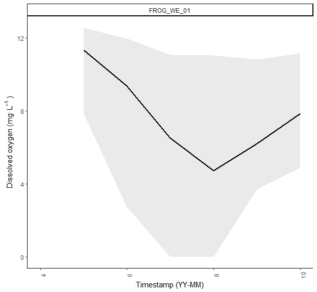
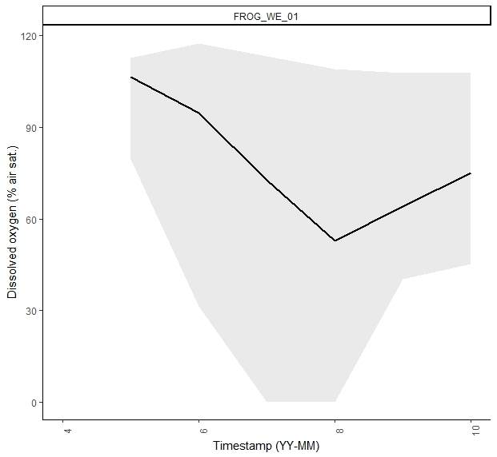
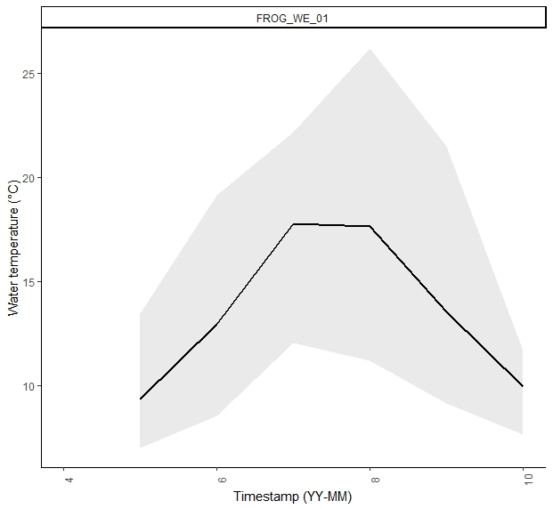

```{r, include = FALSE}
knitr::opts_chunk$set(warning = FALSE, 
                      message = FALSE,
                      collapse = TRUE,
                      comment = "#>",
                      out.width = '100%')

options(knitr.table.format = "latex")

```

```{r setup}
library(waterlogged)
library(knitr)
library(ggplot2)
library(dplyr)
library(tidyr)
library(plotly)
library(purrr)
library(lubridate)
```

# Welcome 

water-logged is a data processing package for water data from continuous water data loggers. The goal of water-logged is to streamline the process from raw data to clean data, document QAQC processing via r scripts, and do so without relying on proprietary software. 

This version of the package was built for data from Onset® HOBO® barometric pressure (U20), dissolved oxygen (U26), conductivity (U24) and TidbiT loggers. Future versions will test this package on data from other types of loggers to try to make it a more universal package. 


$~$

# Prep: Download data from HOBO loggers

$~$

1. Connect shuttle to computer and load in HOBO
2. We recommend saving file name as [SHORTHAND For VARIABLE]_[SITENAME]_[SERIALNUMBER]_[DATEDOWNLOADED YYYYMMDD]
3. Bulk export of csvs: HOBOWARE PRO > Tools > Bulk Export > Select folder containing hobo files

Exported csvs will have this structure (not R-friendly)

   - row 1: Plot Title
   - row 2: headers
   - row 3: start of data
   - column 1: index
   - column 2: DateTime in format mm/dd/yyyy hh:mm
   - column 3: Abs Pres
   - column 4: Temp
   - column 5+ additional logger outputs
   
Here is an example of what the raw file from HOBO should look like:

$~$

```{r raw-ex, echo = FALSE}

baro <- read.csv(system.file("extdata/ex-baro", "raw_data_hobo_u20_baro1.csv", package = "waterlogged"))

head(baro)
```
$~$

# Step 1: Bind logger data for each logging station

$~$

In most cases, there will be data for multiple loggers or downloads for a single station. These need to be bound together to create a single data file for each station. 

Also, data needs to be trimmed to the install and removal dates in case loggers were activated prior to install, or if they were removed before downloading the data (which is typically the case). 

To do this, you will need 2 things:

1. Folder containing raw .csv files exported from HOBOware. 
    - we recommend keeping csv files from different loggers separate in different folders, and organizing logger folders by year and processing-stage. ie. a file path to the raw water-level logger data would be: "data/waterlevel/2024/raw"
2.  A .csv of metadata (NorthThompson_logger_deployments.csv) containing:
    - *sn* serial number of logger
    - *site_station_code* A unique ID for the station where the logger was deployed
    - *timestamp_deployed* timestamp of logger deployment
    - *timestamp_removed* timestamp of logger removal
    - *status* status of logger (logging, lost, removed)
    
Our metadata file looks like this:

$~$

```{r meta-ex, echo = FALSE}

metadat <- read.csv(system.file("extdata/ex-site-attribute", "logger_manager.csv", package = "waterlogged"))

head(metadat)
```
$~$

The function **bind_hobo_files** will load all .csv files in the *path_to_raw_folder*, match loggers with the *metadata* file, trim logger data by to only those timestamps within install/remove dates, and bind data from loggers by each station/location and year. 

*path_to_output_folder* is where you would like the bound files to be saved. 

*logger_type* The type of HOBO logger that produced the raw datafiles. Recognised logger_types are: dissolvedoxygen_U26, baro_U20, waterlevel_U20, conductivity_U24, and temperature_TidbiT


Here is an example of running the function on barometric data from a HOBO U20 logger:

$~$

```{r bind-ex, eval = FALSE}

raw_dir <- "REPLACE WITH DESIRED RAW BARO FOLDER PATH"  #the folder where you've stored your raw csv's (ie. "data/baro/2024/raw")

out_dir <- "REPLACE WITH DESIRED OUTPUT FOLDER PATH FOR BARO DATA"  #from this folder (e.g., "data/baro/2024/raw" or simply the Desktop of your local computer), bind_hobo_files will look for a year folder corresponding to your logger data, and if one isn't made, it will create a new year folder and a "processed" folder to store your processed data (ie. "data/baro/2024/processed")

# to run this example using our data, you can access raw hobo files here:
raw_dir <- system.file("extdata","ex-baro",package = "waterlogged")
# and save output files to a temporary folder:
out_dir <- tempdir()

baro_bound <- bind_hobo_files(path_to_raw_folder = raw_dir, 
                              path_to_output_folder = out_dir, 
                              logger_type = "baro_U20", 
                              metadata = metadat)

```

After you run bind_hobo_files, messages will appear telling you what files were saved where. For our example data, this looks like:
[1] "Data (v0.1) from FROG_WE_01 added to 2024 folder"
[1] "Data (v0.1) from SLUG_ST_01 added to 2023 folder"
[1] "Data (v0.1) from SLUG_ST_01 added to 2024 folder"
[1] "List returned: [1] trimmed and compiled dataset of csvs in raw folder [2] file summary of csvs in raw folder [3] summary plots of data by site_station_code and timestamp"
[[1]]

**Note: the suffix v0.1 indicated that this is the first version of processed data, where raw data has been trimmed, variables renamed, and data saved by calender year. Other suffixes will be introduced later. The suffixes are useful for tracking down errors in data processing steps.**

Now we have individual files for barometric data at each station and year saved in their respective folders, and a trimmed dataset of all input baro files saved in the environment as **baro_bound**.

To see the trimmed and re-bound baro dataset, save the first element of the list as a dataframe:

```{r bind-hidden, echo=FALSE}
baro_bound <- readRDS(system.file("extdata/ex-baro/baro_bound.rds", package = "waterlogged"))

```

```{r bind-ex2}
baro_dat <- data.frame(baro_bound[1])

```
A summary of all raw logger files, their SN and variables are saved as the 2nd object of the list.

```{r bind-ex3}
baro_bound[2]

```

To view a summary plot of the trimmed data, select the third object in the list.

```{r bind-ex4}
baro_bound[3]

```

$~$

This is what the output csvs (individual station data) look like (Compare it to the raw hobo file output from above).

$~$

```{r raw-ind, echo=FALSE}

readRDS(system.file("extdata/ex-baro/SLUG_ST_01_BARO_20240101_20241010_v0.1.rds", package = "waterlogged")) %>%
  head()

```

Use the same function for all other logger types. Let's look at the output of *bind_hobo_files* for a waterlevel logger at a site with the *site_station_code* FROG_WE_01.

$~$

```{r wl-ex, echo = FALSE}
wl_dat <- readRDS(system.file("extdata/ex-waterlevel", "FROG_WE_01_WL_20240101_20241009_v0.1.rds", package = "waterlogged"))

head(wl_dat)

```

$~$

# Step 2: Convert Raw Measurements to Usable Metrics

$~$

HOBO water level loggers are not vented meaning they read both the pressure of the water above them and the atmospheric pressure; this is why water level is currently recorded as "Absolute Pressure", rather than a more useful metric, such as metres. In order to correct for this, we must apply a barometric compensation equation to each timestamp of water level data. Barometric data can be obtained from a U20 installed above water (e.g., in a nearby tree) at a nearby location as the water level logger. Alternatively, hourly barometric pressure can be obtained from nearby weather stations. Regardless, the barometric data used must contain the following columns and formatting:


   - *site_station_code* used to index to metadata for closest baro logger
   - *timestamp*  used to join water level or dissolved oxygen data to baro data for each timestamp
   - *airpress_kPa_U20* barometric pressure is in kPa, used to calculate percent saturation


$~$

We have barometric loggers for some sites, but not all. If a site with a water level logger or dissolved oxygen logger does not have its own barometric logger, we want to use the closest one that has data for the water level or dissolved oxygen time range. We recommend that the atmospheric pressure logger/station be within 30 km (20 miles) of the water level logger. It is also important to note than when using weather station data, it is usually normalized to sea level and therefore additional compensation on the station data should be performed if there is a significant difference in elevation.

**add_nearest_baro** performs three tasks

1. Binds the closest barometric logger to the target logger at each station using metadata provided by the user
2. Fills in gaps in barometric data from one station with baro data from the next closest station
3. Corrects for jumps in pressure due to differences in altitude between logger locations

The input data with barometric data added as additional columns is then exported with suffix `v0.2`.

The metadata must include the following columns:

- *site_station_code* unique identifier for site/station of loggers, must match header and code in input_data
- *logger_type* type of logger located at each site_station_code. Accepted types are **baro_U20**, **waterlevel_U20**, **dissolvedoxygen_U26**. 
- *latitude* in decimal degrees
- *longitude* in decimal degrees

Here is an example of putting together the required metadata

$~$

```{r baro-meta, echo = FALSE}
baro_metadat <- read.csv(system.file("extdata/ex-site-attribute", "site_station_manager.csv", package = "waterlogged"))

head(baro_metadat)

```

$~$

This is an example of running the function, using the bound barometric and waterlevel datasets we made in Step 1
$~$

```{r baro-ex, eval = FALSE}
out_dir <- "REPLACE WITH DESIRED OUTPUT FOLDER PATH FOR WATER LEVEL DATA"

wl_baro_dat <- add_nearest_baro(input_data = wl_dat, 
                                input_logger_type = "waterlevel_U20",
                                path_to_output_folder = out_dir,
                                baro_data = baro_dat,
                                metadata = baro_metadat)

```
$~$
The following message will appear, indicating that barometric data was successfully added to your waterlevel data:
[1] "Barometric pressure data (v0.2) from FROG_WE_01 added to 2024 folder"

**Note: the suffix "v0.2" indicates that this is the second version of processed data, where now the baro logger data have been added as new columns**

This is what the dataset output now looks like:

```{r baro-dat-added, echo = FALSE}
wl_baro_dat <- readRDS(system.file("extdata/ex-waterlevel", "FROG_WE_01_WL_20240101_20241009_v0.2.rds", package = "waterlogged"))

head(wl_baro_dat)

```

Our water level dataset now has a few extra columns: 

  + *baro_code* shows the nearest barometric logger with available data for that timestamp
  + *airpress_kPa_U20* shows the air pressure recorded at the barometric logger
  + *airtemp_C_U20* shows the air temperature recorded at the barometric logger

If the nearest barometric logger does not cover the entire observation period of the dissolved oxygen file, data from the second-nearest barometric logger will be added. Because these loggers may be at different elevations, a small adjustment needs to be made to the pressure values.

*press_diff* the difference in air pressure between subsequent observations at barometric loggers if data from two different loggers were stitched together. This difference is then added/subtracted from the second barometric data to adjust for elevation. These new values are reflected in *airpress_kPa_U20_adj*

The plot that pops up after running **add_nearest_baro** should show a continuous line of varying air pressure values - any breaks or gaps in the line would indicate that an adjustment in pressure between sites of different elevations should be made..

*Note: the air temperature is taken from the barometric logger location, which may not necessarily be the same site as the dissolved oxygen logger. Care should be taken for analyses attributing air temperature to a specific location when the baro_code is not the same as site_station_code*

```{r baro-plot, echo = FALSE}
knitr::include_graphics("figures/step2_add_nearest_baro.png")

```

## Waterlevel: Apply barometric compensation to get water level in metres


We need to convert water level from kPa (water pressure + air pressure) into metres (the height of water at your site). This can be done using the **convert_waterlevel_kPa_m** function. To do this, we need at least one manual measurement of water level (either true depth or stage) taken within the data collection period. 

We keep our manual stage measurements in a separate file. The required columns are:
 - *site_station_code* the name of the logger station, must match with the ID in the waterlevel dataset made previously
 - *timestamp* the time the stage or depth measurement was taken
 - A column containing the manual measurement of water level taken at the logger location, in metres. Default column name is *stage_m*. 

$~$

```{r wl-manual, echo = FALSE}

wl_metadat <- read.csv(system.file("extdata/ex-site-attribute", "site_station_measurements.csv", package = "waterlogged"))

# correctly format time stamps
wl_metadat$timestamp <- as.POSIXct(wl_metadat$timestamp, format = "%m/%d/%Y %H:%M", tz = "UTC")

wl_metadat%>% head()

```

$~$

**convert_waterlevel_kPa_m** requires a few inputs:
 - input_data Dataframe containing timeseries of raw water level in kPa, water temperature
 -  *var_reference_waterlevel_m* Name of column for reference water level in metres
 -  *var_reference_timestamp* Name of column for reference waterlevel timestamp (as.POSIXct)
 -  *reference_type* Type of manual measurement used for correcting water level; Either stage or depth
 -  *reference_data* File containing manual measurements of water level: required variables site_station_code, stage_timestamp, stage_m or depth_m
 - *select_station* site_station_code to ID station for qaqc
 -*select_measurement* Numeric; Select which manual measurement will be used for correcting (default is first measurement, 1)

If you are using HOBO loggers and have not changed the column naming convention, then the following default variable names will not need to be changed. If you have different column names for the following variables, you can enter them here:
 -  *var_watertemp_C* Name of column for water temperature (in degrees Celcius) in input data
 -  *var_waterpress_kPa* Name of column for water pressure (in kPa) in input data
 -  *var_airpress_kPa* Name of column for air pressure (in kPa) in input data
 -  *var_airtemp_C* Name of column for air temperature (in degrees Celcius) in input data

There are a few other inputs, but we will explain them later on. Let's run this function and see how it works.

We run this function once for each site separately. 

$~$

```{r convert-wl, eval = FALSE}

station_wl <- convert_waterlevel_kPa_m(input_data = wl_baro_dat, 
                                       reference_data = wl_metadat, 
                                       reference_type = "depth", 
                                       select_station = "FROG_WE_01", 
                                       var_reference_waterlevel_m = "waterlevel_m_depth", 
                                       path_to_output_folder = out_dir)

```
$~$ 

The following messages will appear:
[1] "Barometric compensation applied to waterlevel (v0.3) from FROG_WE_01 added to 2024 folder"
[1] "Results returned as list: select [1] for waterlevel data in metres, [2] for reference waterlevel dataset, [3] for waterlevel plot to visually check reference values"
[1] "Tip: Do reference water levels observed (orange points) align with the predicted water level (navy line)? If so, great work! Continue onto QAQC. If not, try choosing a different reference water level (ie. select_measurement = 2, etc)"

The output is a list saved under *station_wl*. We can access the outputs in the list like this:

```{r load-wl-m-dat, echo = FALSE}

station_wl <- readRDS(system.file("extdata/ex-waterlevel", "FROG_WE_01_WL_20240101_20241009_v0.3.rds", package = "waterlogged"))


```

$~$ 

```{r get-wl-m-dat}

station_wl_dat <- data.frame(station_wl[1])

station_wl_dat %>% head()
```
$~$ 

You can see we have a bunch of extra columns created in the compensation equation. The only one we really care about is the new *waterlevel_m_U20* which shows waterlevel now in metres.


The second item in the list *station_wl* is a new dataset that shows all available reference datapoints for the selected station. If you would like to use a different reference measurement for waterlevel, you can re-run the previous function with the input for *select_measurement* to be 2 or 3 (the second or third measurement under *ref_m* in the reference dataset). 

$~$ 

```{r get-wl-reference-points}

station_wl[2]

```

$~$ 

Lets look at the plot of waterlevel in metres over time for this station.

$~$ 

```{r get-wl-plot}

station_wl[[3]]
```

$~$ 

The dark blue line is the freshly converted waterlevel in metres, using the first reference value for water depth taken in April 2024 (orange dot). We can see that the first and the last orange dot both align well with the recorded waterlevel. The second dot is way off the waterlevel trendline, and indicates potential drift or measurement error. If we look at the waterlevel metadata file, we can see that under *fieldnote* there is a note indicating "MEASUREMENT_ERROR". This tells us we should ignore the 2nd reference point, and go with the first or second reference values. 

Once you're happy with your waterlevel conversion at this station, you can move onto the next step. If you have more than one waterlevel station that needs to be converted into metres, re-run the previous function with a new input for *select_station* ie. "SLUG_ST_01". If you only have one station, and your happy with the conversion, move onto Step 3: QAQC. 

$~$ 

## Dissolved oxygen: Apply barometric compensation to get DO in % air sat.

If you're working with dissolved oxygen loggers, complete step 1 to get R-friendly DO data, and then run **add_nearest_baro** to add in barometric pressure data into your DO data. The workflow will look like this:

```{r do-dat-step1-2, eval = FALSE}

raw_dir <- "REPLACE WITH DESIRED RAW DISSOLVED OXYGEN FOLDER PATH"  #the folder where you've stored your raw csv's (ie. "data/dissox/2024/raw")

out_dir <- "REPLACE WITH DESIRED OUTPUT FOLDER PATH FOR DISSOLVED OXYGEN DATA"  #from this folder (ie. "data/baro/2024/raw" or simply the Desktop of your local computer), bind_hobo_files will look for a year folder corresponding to your logger data, and if one isn't made, it will create a new year folder and a "processed" folder to store your processed data (ie. "data/baro/2024/processed")

do_dat <- bind_hobo_files(path_to_raw_folder = raw_dir, 
                              path_to_output_folder = out_dir, 
                              logger_type = "dissolvedoxygen_U26", 
                              metadata = metadat)

do_baro_dat <- add_nearest_baro(input_data = do_dat, 
                                input_logger_type = "dissolvedoxygen_U26",
                                path_to_output_folder = out_dir,
                                baro_data = baro_dat,
                                metadata = baro_metadat)

```

Here is the output of bound DO and barometric pressure for one site, FROG_WE_01.

```{r do-baro, echo=FALSE}

do_baro_dat <- readRDS(system.file("extdata/ex-dissox/FROG_WE_01_DO_20240410_20241014_v0.2.rds", package = "waterlogged"))


do_baro_dat$timestamp <- as.POSIXct(do_baro_dat$timestamp, format = "%Y-%m-%d  %H:%M:%S", tz = "UTC")

head(do_baro_dat)

```

$~$

Now that we have barometric pressure values for each of our dissolved oxygen values, we can compute the percent air saturation of dissolved oxygen using the function **convert_do_mgl_percsat**

$~$

```{r do-mgl-percsat, eval = FALSE}

do_baro_sat <- convert_do_mgl_percsat(input_data = do_baro_dat, 
                                      path_to_output_folder = out_dir)

do_baro_sat %>% head()

```


```{r do-percsat-load, echo = FALSE}

do_baro_sat <- readRDS(system.file("extdata/ex-dissox", "FROG_WE_01_DO_20240420_20241009_v0.3.rds", package = "waterlogged"))

do_baro_sat %>% head()

```

Dissolved oxygen is now available in percent air saturation in column *do_percsat_U26*. This file is automatically saved in the appropriate year folder in your designated *out_dir* with suffix *v0.3*.

If we look at the range of DO in % sat, we can see there are some high values greater than 100% air sat and some low values that are less than zero...this indicates we need to do some QAQC and clean up the data. Time for Step 3 (you can jump straight to the Dissolved Oxygen section)!

$~$


# Step 3: QAQC

From our experience with hydrology data, it is then necessary to investigate data from each station individually. This can be done efficiently by overlaying data from multiple loggers (if applicable) from the same station and time period. Visual investigation of data time series and automated flags allows the user to confirm periods where loggers were dry, frozen or disturbed by human/natural cause. All manual data processing is saved in an R script for tracking QAQC of each logger type each year, and recorded as additional qaqc columns in clean data files.

$~$

## Waterlevel

```{r get-ex-wl-b, echo=FALSE}

# this file has artificial errors in it to show qaqc examples
#read in to overwrite station_wl_dat

station_wl_dat <- readRDS(system.file("extdata/ex-waterlevel", "FROG_WE_01_WL_20240101_20241009_v0.3b.rds", package = "waterlogged"))


```

If you came here straight from step 2, you may already have the water level data with barometric compensation loaded in your environment (ie. station_wl_dat). If not, you can grab it from your computer, wherever you selected as *path_to_output_folder*. The water level with barometric compensation is saved as a file ending with *v0.3*. Or, if you have water level data from multiple stations to clean, you can load them all using the function *get_logger_data*

$~$

```{r get-all-wl-dat, eval = FALSE}

wl_dat <- get_logger_data(path_to_data = paste0(out_dir, "/2024/processed/"),
                          logger_type = "waterlevel_U20",
                          data_processing = "v0.3")

```

$~$

The function *waterlevel_qaqc* will take your waterlevel data from step 2 (baro added, converted to metres ie. v0.3), automatically remove outliers and flag potential errors according to the following rules:

- *NEGATIVE_WL* if waterlevel is a negative value, corrected to 0
- *LOGGER_ICE* if water temperature is less than -1C, value is removed
- *NEGATIVE_WT* if water temperature is between 0C and -1C, the value is corrected to 0C
- *FLAG_DRY* if water pressure is equal to or less than air pressure and water temperature is greater than 19C
- *FLAG_ICE* if water temperature is less than 0.3C
- *FLAG_DISTURBANCE* if water level changes by more than 0.1m (10 cm) in 1 hour then add DISTURBANCE flag column (logger wire break or adjusted)

Required inputs are:

- *input_data* the waterlevel data v0.3 (can be data from a single site, or merged data across multiple sites)
- *select_station* filters dataset to desired station; unique site_station_code that identified a site/station where a logger is located
$~$

```{r wl-qaqc}
station_wl_dat2 <- waterlevel_qaqc(input_data = station_wl_dat,
                select_station = "FROG_WE_01")

```

$~$ 

Lets look at the data to see what QAQC flags were made. Plotly is used as an interactive plotting feature to allow the user to overlay water data from multiple loggers ie. compare water temperature from water level logger to air temperature from barometric logger at the same site) and zoom in on time periods of interest; this helps to identify data where a logger has gone dry, frozen or been disturbed. 
$~$

```{r wl-qaqc2}

station_wl_dat2[[2]]

```

$~$

The top plot shows the waterlevel in blue. The lighter blue is the raw values, and the darker blue shows the automatically adjusted values from QAQC.

The bottom plot shows air temperature (from barometric data) in orange, and water temperature overlayed in teal. 

You can zoom in on sections of the plot by clicking and dragging with your mouse. You can see data point values by hovering your mouse over the data point on the graph. You can also toggle data sources on and off by clicking on the data type in the legend. 


Many datapoints were flagged - a long section from Jan to Apr was flagged for *ICE*, and some periods in July and August were flagged as *DRY*. There are also a few points that were flagged as *DISTURBANCE*. Using your mouse, you can zoom in on the plotly graph to see the flagged sections more clearly. 

### Dealing with large swings in waterlevel overwinter: ice spikes

Lets start with the ice flags. In January, you can see the air temperature drops, and the waterlevel appears to be increasing by nearly half a metre - in this system, we know this is not true, and is likely the result of snow and ice accumulation on top of the logger. We call this an ice spike. Hover your mouse over the blue line at the start and end of the peak to see the timestamp. It looks like this one starts "2024-01-11 08:00:00" and ends "2024-02-07 07:00:00". We can flatten this ice spike using the function *adjust_waterlevel_spike*.

```{r wl-spike}
# first, make sure you save the data output of waterlevel_qaqc as a dataframe 
station_wl_dat2 <- data.frame(station_wl_dat2[1])

#then enter the desired timestamp range into adjust_waterlevel_spike

station_wl_dat3 <- adjust_waterlevel_spike(input_data = station_wl_dat2, 
                                           select_station = "FROG_WE_01",
                                           timestamp_start = "2024-01-11 08:00:00",
                                           timestamp_end = "2024-02-07 07:00:00", 
                                           reason_to_adjust = "ice")

```

$~$

To see the change we made, run *waterlevel_qaqc* again, but this time with the input variable *plot_only* set to TRUE.

$~$

```{r wl-spike-fig}
waterlevel_qaqc(input_data = station_wl_dat3,
                select_station = "FROG_WE_01",
                plot_only = TRUE)

```

$~$

Now the ice spike in *waterlevel_m_adj* has been flattened (it fits a linear slope between the start and end points). The adjustment is noted in the new QAQC columns. 

$~$

```{r wl-spike2}

data.frame(station_wl_dat3[c(245:255),c(20:24)] )

```

$~$

There is another small ice spike in March, where the temperature drops again and snow accummulation is likely. We can repeat the same process again to flatten it. 

```{r wl-spike3}

station_wl_dat4 <- adjust_waterlevel_spike(input_data = station_wl_dat3, 
                                           select_station = "FROG_WE_01",
                                           timestamp_start = "2024-03-24 05:00:00",
                                           timestamp_end = "2024-03-24 11:00:00", 
                                           reason_to_adjust = "ice")

waterlevel_qaqc(input_data = station_wl_dat4,
                select_station = "FROG_WE_01",
                plot_only = TRUE)

```

### Dealing with a sudden shift in waterlevel: cable break

Moving onto the next QAQC flag: FLAG_DISTURBANCE (black triangle on plotly graph). This flag appears when the waterlevel drops or rises by over 0.1m in 1 hour. This may not always indicate a disturbance to the logger, as is the case in a sudden flood or significant rainfall event. You can verify if this is a natural flood by zooming in on the time periods where disturbance was flagged for August 24th and September 29th. Although the waterlevel has risen quickly, you can see that each point is progressively increasing, and then decreases over time, signalling a flood event. We can ignore these flags. 

Look at the disturbance flag on Oct 1st. Here, we see a sudden jump in waterlevel from 0.47m up to 0.95m in 1 hour. The waterlevel does not gradually come back down, but stays around 0.95 until the logger is removed on Oct 7th. If we check our field notes, it says "CABLE_BREAK", meaning that the cable was found broken upon station inspection. 

We can use the function **adjust_waterlevel_cablebreak** to remove this jump in waterlevel. Indicate the timestamp when the jump starts, in this case, "2024-10-01 18:00:00 UTC", and the timestamp when the jump ends, in this case, it is just the next hour, "2024-10-01 19:00:00 UTC". 

```{r cable-break}

station_wl_dat5 <- adjust_waterlevel_cablebreak(station_wl_dat4, timestamp_start = "2024-10-01 18:00:00", timestamp_end = "2024-10-01 19:00:00", select_station = "FROG_WE_01")


waterlevel_qaqc(input_data = station_wl_dat5,
                select_station = "FROG_WE_01",
                plot_only = TRUE)
```

$~$

## Dissolved Oxygen

The function **dissox_qaqc** takes the raw dissolved oxygen data and removes outliers and flags data by the following rules:

  + If DO recorded an error code (-888.88), this value was set to *NA*, and *qaqc_note* as "DO_ERROR"
  + If water temperature recorded an error code (-888.88), this value was set to *NA*, and *qaqc_note* as "TEMP_ERROR"
  + If DO measurement was between 0 and -1 mg/L, DO was set to 0 mg/L and 0% saturation
  + If DO measurement was less than -1, DO values was removed (*NA*) and *qaqc_code* set to "NEGATIVE_DO"
  + If DO greater than 21 mg/L, DO value removed and *qaqc_code* set to "OUTLIER_DO"
  + If water temperature measurement was less than 0, both temperature and DO values were removed (*NA*) and *qaqc_code* set to "LOGGER_ICE"
  
Suspicious data is flagged for user confirmation:

  + if water temp within 2 degrees of air temp and over 100% air sat for 12 consecutive hours *qaqc_flag* "FLAG_DRY"
  + if water temp is less than 0.3C then *qaqc_flag* set to "FLAG_ICE"
  
All adjustments made to the data are saved as new variables with the ending *_adj*
 
Optional inputs are:

- *var_waterlevel_m*: if the you have already QAQC'd the waterlevel data for this site, you can join the datasets and input the variable name for waterlevel in metres here. This helps see mismatches in water temperature and to identify when the logger may be dry. If you are using our naming convention, this would be *waterlevel_m_U20_adj*.
- *var_watertemp_C_2*: if the you have already QAQC'd the waterlevel data for this site, you can join the datasets and input the variable name for water temperature in degrees Celcius here. This helps see mismatches in water temperature and to identify when the logger may be dry. If you are using our naming convention, this would be "watertemp_C_U20_adj".

$~$

If you have waterlevel data that you'd like to add in, join the WL and DO dataset by timestamp. If you dont want to add in any waterlevel data, you can skip this chunk.

```{r bind-wl-do}

# Here I am inputting the final QAQC'd waterlevel data made previously in Step 3: Waterlevel: station_wl_dat5. If you are using another dataset, enter the object name of your clean waterlevel data instead. I filtered to only the columns I need for QAQC: waterlevel and watertemp. 

frog_wl_wt <- station_wl_dat5 %>% select(timestamp, waterlevel_m_U20_adj, watertemp_C_U20_adj)

do_baro_sat_wl<- left_join(do_baro_sat, frog_wl_wt, by = "timestamp")

do_baro_sat_wl %>% head()

```

$~$

```{r run-do-qaqc}

station_do_dat<- dissox_qaqc(input_data = do_baro_sat_wl, 
                               select_station = "FROG_WE_01",
                               var_waterlevel_m = "waterlevel_m_U20_adj",
                               var_watertemp_C_2 = "watertemp_C_U20_adj")

```

$~$

Lets look at the data to see what QAQC flags were made. Plotly is used as an interactive plotting feature to allow the user to overlay water data from multiple loggers, e.g., compare water temperature from dissolved oxygen logger to air temperature from barometric logger at the same site) and zoom in on time periods of interest; this helps to identify data where a logger has gone dry, frozen or been disturbed. 

$~$

```{r do-qaqc2}

station_do_dat[[2]]

#save the output dataframe 
station_do_dat2 <- data.frame(station_do_dat[[1]])
```

$~$

The top plot shows the dissolved oxygen in green. The lighter green is the raw values, and the darker green shows the automatically adjusted values from QAQC. Notice that in May there were many error readings of "-888.88" that have been adjusted to "NA". You can zoom in to see the gaps in the dark green line, while the light green line drops down to -888.88 mg/L (beyond the range shown on the plot).

The black X's indicate a data point flagged as dry, and the black O's indicate a datapoint flagged as ice. 

The middle plot (if you included waterlevel logger data) shows water level in navy blue. 

The bottom plot shows air temperature (from barometric data) in orange, with water temperature from the dissolved oxygen logger (watertemp_C_1) overlayed in teal, and (if you included waterlevel logger data) water temperature from the waterlevel logger in yellow.

You can zoom in on sections of the plot by clicking and dragging with your mouse. You can see data point values by hovering your mouse over the data point on the graph. You can also toggle data sources on and off by clicking on the data type in the legend. 

Many datapoints were flagged - a long section from April to May  was flagged for *ICE* and *DRY*, and some periods in May, July and August were flagged as *DRY*. There is also a stretch in Sept that was flagged as *DRY*. Using your mouse, you can zoom in on the plotly graph to see the flagged sections more clearly. 

$~$

Look for sections in the graph where:

  + water temperature (orange) variation overlaps completely with air temperature variation (red). This suggests that the DO logger is dry. 
  + When air temperature is > OC, and DO (light blue) jumps up to >100% air sat. suddenly. This indicates the DO logger may be dry. 
  + When air temperature is < OC, and DO (light blue) jumps up to >100% air sat. suddenly. This indicates the DO logger is in ice. 

$~$

### Dealing with ice

$~$

From the beginning of the dataset to "2024-05-06 21:00:00" DO shows large swings each day (dense green patch of lines in top plot). This coincides with the dissolved oxygen logger water temp overlapping competely with air temperature (dense teal and orange  patches of lines in bottom plot), but NOT with the water temperature recorded on the waterlevel logger (yellow line, bottom plot). This is clearly a time when the DO logger was frozen in ice, while the waterlevel logger was not. We should remove this section of DO data. 

The function **adjust_logger_NA** takes the inputs of your station data (*input_data*), the timestamp for the start of the dry period (*timestamp_start*) and the timestamp for the end of the dry period (*timestamp_end*). The timestamps must be formatted correctly as POSIXct objects in the same timezone as your dataset using the variables *timestamp_format* and *timestamp_timezone* (Note: by default we force the UTC timezone so that R doesnt automatically correct for daylight saving since our loggers don't correct for daylight savings - they just stay in Pacific Standard Time all year round). 
You need to tell the function why you are removing the data (ie. reason_to_adjust = "ice"  )

```{r adjust-do-ice}

station_do_dat3 <- adjust_logger_NA(input_data = station_do_dat2, select_station = "FROG_WE_01", 
                            timestamp_start = "2024-04-10 13:00:00",
                            timestamp_end = "2024-05-06 21:00:00", 
                            logger_to_adjust = "dissolvedoxygen_U26",
                            reason_to_adjust = "ice" )


```

$~$

Call dissox_qaqc again with the variable plot_only set to TRUE to show the changes we made. Note that now only the raw do data (light green) is shown during the ice period, and the do_mgl_adj values have been removed.

$~$
```{r do-ice-plot}
dissox_qaqc(input_data = station_do_dat3, 
                               select_station = "FROG_WE_01",
                               var_waterlevel_m = "waterlevel_m_U20_adj",
                               var_watertemp_C_2 = "watertemp_C_U20_adj",
                               plot_only = TRUE)

```

### Dealing with dry periods

Next, lets look at the other dry flags. If we zoom into the first one on May 14th, we can see that water temperature on both loggers is very similar to air temperature. While this should flag a potential dry spot, the water level does not appear to drop during this time. There also isn't large fluctuation in DO or water temperature during this period. We can ignore this flag. The other flags in June and August also dont show waterlevel dropping during this time, so we can ignore them as well. 

However, in the long stretch of dry flags in Sept., there is a clear stretch of time where waterlevel dropped, DO rose to >10 mg/L amd stayed high, while water temperature swings in alignment with air temperature - these are all clues that the logger is indeed dry. We can remove this dry period with the same function as above, but with the *reason_to_adjust* set to "dry".

```{r adjust-do-dry}

station_do_dat4 <- adjust_logger_NA(input_data = station_do_dat3, 
                                    select_station = "FROG_WE_01", 
                                    timestamp_start = "2024-09-09 06:00:00", 
                                    timestamp_end = "2024-09-25 21:00:00", 
                                    logger_to_adjust = "dissolvedoxygen_U26",
                                    reason_to_adjust = "dry" )


dissox_qaqc(input_data = station_do_dat4, 
                               select_station = "FROG_WE_01",
                               var_waterlevel_m = "waterlevel_m_U20_adj",
                               var_watertemp_C_2 = "watertemp_C_U20_adj",
                               plot_only = TRUE)

```

$~$

# Step 4: save clean site data

$~$

*write_clean_data* drops unnecessary columns and saves the file to the output folder with a standardized naming convention ending with suffix *v1.0* to show this is the clean data. 

$~$

```{r write-clean-data, eval = FALSE}

write_clean_data(input_data = station_do_dat4,
                 logger_type = "dissolvedoxygen_U26",
                 path_to_output_folder = out_dir)

```

$~$

The clean data file looks likes this:

$~$

```{r ex-clean-dat}

do_clean <- readRDS(system.file("extdata/ex-dissox/FROG_WE_01_DO_20240410_20241014_v1.0.rds", package = "waterlogged"))

head(do_clean)
```

Repeat steps 3 and 4 for each logger/station you have.

We recommend saving the R script with all function inputs as QAQC documentation for future reference and for transparency.

$~$

# Conductivity

Much like with the water level and dissolved oxygen loggers, conductivity loggers may undergo a similar QA/QC process to remove erroneous data from dry, ice, and/or disturbance events. The data should be further processed to correct for sensor drift and compensate for temperature, which will be outlined in subsequent steps here.

Let's start by reading in some example raw conductivity data:

```{r get-ex-conductivity, echo=FALSE}

# read in example conductivity file to demonstrate QAQC
cdat <-  read.csv(system.file("extdata/ex-conductivity","CO_BUGS_WE_01_20240421_20250418_v0.1.csv", package="waterlogged")) %>% 
  mutate(timestamp = as.POSIXct(timestamp, format = "%m/%d/%Y %H:%M", tz = "UTC"))

head(cdat)
```

The function **conductivity_qaqc** takes raw conductivity data and flags events where data may have been compromised (i.e., the logger was either dry or frozen) according to the following rules: 

- *LOGGER_ICE* if water temperature is less than -1C, value is removed
- *NEGATIVE_WT* if water temperature is between 0C and -1C, the value is corrected to 0C
- *FLAG_DRY* if conductivity is less than 10 uS/cm
- *FLAG_ICE* if water temperature is less than 0.3C
- *FLAG_DISTURBANCE* if conductivity changes by more than 200 uS/cm in an hour (this does not necessarily indicate an issue with the logger, but it might warrant further investigating potential causes of what triggered this spike)

Required inputs are:

- *input_data* the conductivity data v0.1 (can be data from a single site, or merged data across multiple sites)
- *select_station* filters dataset to desired station; unique site_station_code that identified a site/station where a logger is located

Optional inputs are:
- *var_airtemp_C*: if you have a nearby logger that measures air temperature (e.g., a baro HOBO U20 or similar), you can join the dataset and input the variable name for air temperature in degrees Celsius here. This adds a supplemental rule for *FLAG_DRY* to check if water temperature is within 2C of air temperature for six consecutive hours. If you are using our naming convention, this would be *airtemp_C_U20*. Air temperature and water temperature will be plotted on a separate graph from conductivity.
- *var_waterlevel_m*: if the you have already QAQC'd the water level data for this site, you can join the datasets and input the variable name for water level in metres here. This is an additional visual aid to identify when the logger may be dry (but it does not specifically flag the conductivity data). If you are using our naming convention, this would be *waterlevel_m_U20_adj*.

$~$

To fully illustrate how additional loggers can help with the QC process, let's join both air temperature and water level to the conductivity data using the timestamp column as the primary key to link records

```{r join-at-wl}
# The supplemental data we're adding here is formatted in the same way that data cleaned and written by this package would be produced. 

# If you're using multiple loggers for air temperature, you can use the **add_nearest_baro** function to join up the geographically closest loggers for each record.

# We only need to keep the relevant columns. If your supplemental datasets contain data from multiple sites, make sure they are also filtered to only include a single site
atdat <-  readRDS(system.file("extdata/ex-baro", "BUGS_WE_01_BARO_20240421_20250418_v1.0.rds", package = "waterlogged")) %>%
  select(timestamp, airtemp_C_U20_adj)

wldat <- readRDS(system.file("extdata/ex-waterlevel", "BUGS_WE_01_WL_20240421_20250418_v1.0.rds", package = "waterlogged")) %>% 
  select(timestamp, waterlevel_m_U20_adj, starts_with("wl_qaqc"))

co_at_wl <- left_join(cdat, atdat, by = "timestamp") %>% 
  left_join(wldat, by = "timestamp")

head(co_at_wl)
```

$~$

## Step 1: Run automated QA/QC function

Here is an example of how **conductivity_qaqc** is run with the optional arguments. We're using the default arguments for 
*var_conduct_uScm* and *var_watertemp_C* as the raw data is formatted as it if were tidied using **bind_hobo_files**. If your conductivity and temperature columns have different names, be sure to specify them in the function's arguments.

```{r run-co-qaqc}
devtools::load_all()
cond_dat <- conductivity_qaqc(co_at_wl,
                              var_airtemp_C = "airtemp_C_U20_adj",
                              var_waterlevel_m = "waterlevel_m_U20_adj",
                              select_station = "BUGS_WE_01")
```

$~$

Let's look at the data to see what QAQC flags were made. Plotly is used as an interactive plotting feature to allow the user to overlay water data from multiple loggers, e.g., compare water temperature from the conductivity logger to air temperature from the barometric logger at the same site) and zoom in on time periods of interest; this helps to identify data where a logger has gone dry, frozen or been disturbed. 

$~$

```{r co-qaqc2}

cond_dat[[2]]

# save the output dataframe

cond_dat2 <- data.frame(cond_dat[[1]])
```

You can zoom in on sections of the plot by clicking and dragging with your mouse. You can see data point values by hovering your mouse over the data point on the graph. You can also toggle data sources on and off by clicking on the data type in the legend. 

The top plot shows the conductivity in blue, with the raw values in a lighter shade and any adjustments to the data in a darker shade. The function does not make any automatic adjustments to conductivity values (as with the water level and dissolved oxygen QAQC functions), so we would only expect to see differences in the two lines if the data had been adjusted by another function (e.g., drift correction or manual removal of values). 

The black points indicate data that have been flagged for manual inspection:
- triangle: disturbance (change in conductivity >200 uS/cm in one hour)
- X: dry (conductivity < 10 uS/cm and/or water temp within 2C of air temp for at least 6 consecutive hours)
- circle: ice (water temp < 0.3C)

The second plot shows water temperature of the conductivity logger in green and (optionally) air temperature in light blue.

A third plot is shown if water level data were added. Note the difference between "FLAG_DRY" and "LOGGER_DRY" — the former indicates suspicious data, but the latter indicates data were intentionally removed and the flag represents the reasonal for the removal. 

Since flags rely on automated rules to trigger, they are not always indicative of a true issue with the data, which is why we recommend manual inspection and overlaying data from one or more supplemental loggers to diagnose what might have happened.

$~$

#### Dealing with dry periods

In the conductivity plot, we see a drop to nearly 0 uS/cm from 2024-08-07 at 12:00 to 2024-09-12 at 12:00 — this roughly coincides with when the water level logger was noted to be dry. Furthermore, we can see on the temperature plot where water and air temperature significantly overlap for an extended period of time. All three indicators suggest that the site went dry during this time frame (the week-long discrepancy between the conductivity and water level loggers going dry suggest the latter's sensor may have been situated slightly higher up).

The function **adjust_logger_NA** takes the inputs of your station data (*input_data*), the timestamp for the start of the dry period (*timestamp_start*), and the timestamp for the end of the dry period (*timestamp_end*). The timestamps must be formatted correctly as POSIXct objects in the same timezone as your dataset using the variables *timestamp_format* and *timestamp_timezone* (Note: by default we force the UTC timezone so that R doesn't automatically correct for daylight saving since our loggers don't correct for daylight savings - they just stay in Pacific Standard Time all year round). 
You need to tell the function why you are removing the data (ie. reason_to_adjust = "dry" )

```{r adjust-co-dry}
cond_dat3 <- adjust_logger_NA(input_data = cond_dat2, 
                              select_station = "BUGS_WE_01",
                              timestamp_start = "2024-08-07 12:00:00",
                              timestamp_end = "2024-09-12 12:00:00",
                              logger_to_adjust = "conductivity_U24",
                              var_watertemp_C = "watertemp_C_U24",
                              reason_to_adjust = "dry")
```

$~$

Let's re-examine the data by calling **conductivity_qaqc** and using the argument *plot_only = TRUE* to only visualize the changes without reapplying the automated QAQC flags.

$~$

```{r co-dry-plot}
conductivity_qaqc(input_data = cond_dat3,
                  select_station = "BUGS_WE_01",
                  var_conduct_uScm = "conduct_uScm_U24",
                  var_watertemp_C = "watertemp_C_U24",
                  plot_only = TRUE)
```

We should see that the time period we specified between 8/07 and 9/12 should be missing from the adjusted variable columns, but still present in the raw columns. In the data, the adjusted rows will appear as *NA* with *co_qaqc_code = LOGGER_DRY*. 

#### Dealing with ice periods

We can see that the period between 2025-01-31 and 2025-03-04 have been flagged as "ice" in the conductivity plot as the water temperature was recorded as below 0.3C. If the logger were truly encased in ice, we should expect to see conductivity sharply drop to near 0 uS/cm, similarly to if the logger were dry, because ice has poor conductivity. 

However, we know from the water level logger that this was not the case as that data remained unadjusted for that time period and that the loggers are still approximately one metre underwater. It is likely that even if the surface of the water had frozen, the logger was deep enough that its readings were unaffected. Therefore, it is safe to ignore the ice flags for this dataset. 

If we wanted to remove the ice period, we would follow the same arguments for **adjust_logger_NA** as for the dry example, but instead specify *reason_to_adjust = "ice"*.

$~$

#### Interpreting disturbance spikes

We can disregard the conductivity spikes on 8/19 and 9/08 since we know the logger to still have been dry then. These are likely sensor artifacts. If these spikes were observed during a period of known immersion, then alternative explanations should be considered, e.g., localized contamination events from a heavy rainfall event or brief sediment disturbance. In these instances, we suggest keeping the data in.

$~$

## Step 2: Correcting for sensor drift (OPTIONAL) 

Conductivity loggers deployed for extended periods of time, or in particularly fouled waters, can be subject to sensor drift. As it is not always practical to re-calibrate loggers in the field, we can compensate for potential drift by using spot reference measurements, such as from a handheld YSI® conductivity meter that has been calibrated in the lab prior to use. 

Your field measurements should be in a readable .csv file and formatted something like this:

```{r echo=false}
ysi_data <- read.csv("inst/extdata/ex-site-attribute/site_station_waterquality.csv")
head(ysi_data)
# 
# ysi_data$ysi_conduct_uScm[3] <- 85.2
# ysi_data$ysi_conduct_uScm[5] <- 60.8
```

We can then apply the **correct_drift** function to the dataset we performed automated QA/QC on earlier. The required inputs are:

- *input_data* the conductivity data (for this example, we'll be using the data we just put through the automated QA/QC function)
- *ref_data* the dataset containing the spot reference measurements
- *select_station* ensures the data are only from a singular station
- *var_ref_watertemp_C* the reference data column that contains the spot temperature measurement
- *var_ref_conduct_uScm* the reference data column that contains the spot conductivity measurement. Make sure you are using the device's *conductivity* readings and not *specific conductance*
- *var_ref_timestamp* the reference data column that contains the timestamp of the measurement. Like with the logger data, it should be formatted as "mm/dd/yyyy hh:mm" (e.g., "10/09/2024 15:00")

```{r co-drift-correction}
# We're using the default column names for all of the variables, but if your input or reference columns are labeled differently, they need to be specified appropriately. 
# We're using the "_adj" columns from the input data because we want to preserve the changes we made to the data during QA/QC, i.e., dropping the rows when the logger was dry

cond_dat4 <- correct_drift(input_data = cond_dat3,
                           ref_data = ysi_data,
                           select_station = "BUGS_WE_01",
                           var_ref_watertemp_C = "ysi_watertemp_C",
                           var_ref_conduct_uScm = "ysi_conduct_uScm",
                           var_ref_timestamp = "ysi_timestamp")
```

We can compare how the drift-corrected data look compared to the uncorrected values in a plotly output. 

```{r get-co-drift-plot}
cond_dat4[[3]]
```

The function works by taking the difference between the logger and reference measurements between two spot measurement events and applies — to each logger record — a correction that scales based on the amount of time that has passed between the first spot measurement and the next. This is because we assume that sensor drift will increase as time passes. 

If you did not take a spot measurement within 2 hours of the start of the dataset, the function will assume that the logger data starts out perfectly calibrated. 

If a reference measurement is significantly different from the corresponding logger record, we recommend either further examining the raw data (e.g., check for excessive fouling or disturbance) or excluding the outlier measurement in the drift correction function by manually removing it from the reference dataset.

$~$

## Step 3: Applying temperature compensation

The final step in processing raw conductivity data is compensating for temperature, which produces a value called *specific conductance*. Specific conductance is the recommended measurement to be used when making comparisons between different sites or times because it removes temperature as factor, leaving only the influence of the dissolved ions. 

```{r co-apply-temp-comp}
cond_dat5 <- conduct_temp_comp(input_data = cond_dat4[[1]],
                               var_conduct_uScm = "conduct_uScm_U24_adj_dc",
                               var_watertemp_C = "watertemp_C_U24_adj_dc")
```

The function applies a non-linear formula for natural water per the ISO EN278888 standard — this is only appropriate for freshwater lakes and streams. Currently, the function does not support specific conductance conversion for saltwater or brackish water. 

```{r show-spc}
head(cond_dat5)
```

We can examine how specific conductance differs from uncompensated conductivity

```{r spc-plot, echo=FALSE}
p <- ggplot(cond_dat5, aes(x = timestamp)) +
  geom_line(aes(y = spc_uScm_U24, colour = "Spec. cond (uS/cm)")) +
  geom_line(aes(y = conduct_uScm_U24_adj_dc, colour = "Conductivity (uS/cm)"), linetype = 2) +
  geom_line(aes(y = watertemp_C_U24_adj_dc, colour = "Temperature (C)"), alpha = 0.5) +
  scale_colour_manual(values = c("Spec. cond (uS/cm)" = "#1f77b4",
                                 "Conductivity (uS/cm)" = "#ff7f0e",
                                 "Temperature (C)" = "#d62728")) +
  labs(title = "Specific conductance vs. conductivity",
       x = "Timestamp",
       y = "",
       colour = "") +
  theme_classic()

ggplotly(p)
```

$~$

## Step 4: Write clean data 

This fully processed conductivity data can then be passed on to the **write_clean_data** function.

```{r write-clean-data, eval=FALSE}
write_clean_data(input_data = cond_dat5,
                 logger_type = "conductivity_U24",
                 path_to_output_folder = out_dir)
```

```{r ex-clean-dat, echo=FALSE}
co_clean <- readRDS(system.file("extdata/ex-conductivity", "BUGS_WE_01_CO_20240421_20241231_v1.0.rds", package="waterlogged"))

head(co_clean)
```


$~$

# Step 5: Summarizing data

*get_logger_data* is a function to help collate or find specific logger data. Specific loggers/stations can be selected by the unique ID (ie. site_station_code) using *select_station* (default is "all", which will grab files from all stations in folder). 

By default, this function will look for clean data (ie. files with suffix ending in v1.0). If you would like to call in data from a specific processing stage, like where you left off after step 2, you can adjust the input for *data_processing* to "v0.1" for raw data, "v0.2" for data that has been bound with baro data, and "v0.3" for data that has had barometric compensation applied.

This function can also be used to provide summaries of data by year, site_station_code, and logger_type. For example, if we wanted to get a monthly summary of DO values for all sites and all clean data we could execute the following:

$~$

```{r data-sum, eval = FALSE}

get_logger_data(path_to_data = "C:/Users/loscerbod/Desktop/2024/clean", logger_type = "dissolvedoxygen_U26", data_processing = "clean", temporal_scale = "monthly")

```

$~$

The output looks like this:

$~$

```{r get-sum, echo = FALSE}
datsum <- readRDS(system.file("extdata/ex-dissox", "FROG_WE_01_DO_2024_monthly.rds", package = "waterlogged"))

head(datsum[c(2:7),])

```

$~$

```{r sum-plots, echo = FALSE}




```
